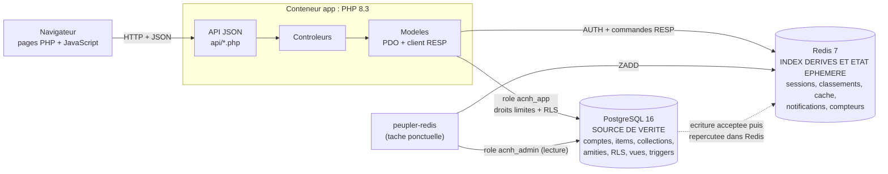
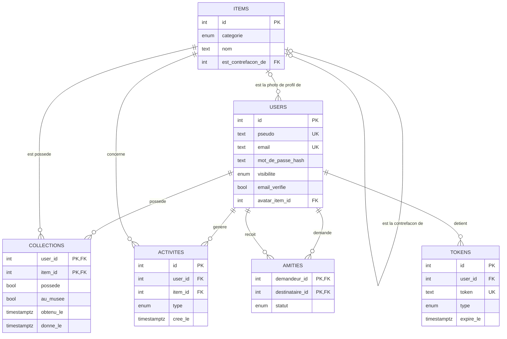

# Nook Manager — document de présentation

Projet final · Bases de données relationnelles et non relationnelles · Mastère 1 Développement · EFREI

Les chiffres et sorties de ce document viennent d'une exécution réelle de la pile (1 503 joueurs, 272 560 lignes de collection) ; les commandes pour les reproduire sont données avec chaque exemple.

---

## 1. Le projet

**Contexte.** *Animal Crossing: New Horizons* demande de collectionner plus de 650 éléments : habitants, poissons, créatures marines, insectes, œuvres d'art. Les joueurs cochent ce qu'ils ont trouvé et ce qu'ils ont donné au musée, aujourd'hui sur papier ou dans des tableurs. **Nook Manager** est une application web qui remplace cela : chaque joueur a un compte, une collection, des amis, et peut se comparer aux autres.

**Utilisateurs.** Des joueurs, avec trois niveaux de confidentialité par profil : public, amis seulement, privé.

**Fonctionnalités principales.**

| Fonction | Où elle vit |
| --- | --- |
| Catalogue des 660 éléments (687 lignes avec les contrefaçons d'art), recherche, filtres par mois, lieu, « disponible maintenant » | PostgreSQL |
| Collection personnelle : « je l'ai », « au musée », retrait | PostgreSQL |
| Comptes : inscription, vérification d'email, mot de passe oublié, suppression de compte | PostgreSQL |
| Amis : demandes, acceptation, comparaison de deux collections, « ce que mes amis ont et pas moi » | PostgreSQL |
| Visibilité des profils (public / amis / privé), appliquée par la base elle-même | PostgreSQL (Row Level Security) |
| Classement global et par catégorie, records de l'île | **Redis** (ensembles triés) croisé avec PostgreSQL |
| Sessions, limitation des tentatives de connexion, compteurs d'activité | **Redis** |
| Notifications temporaires (demande d'ami reçue) | **Redis** |
| Cache des statistiques et des tailles de catalogue | **Redis** |

---

## 2. Architecture



**Composants** (un seul `docker-compose.yml`) :

| Service | Image | Rôle |
| --- | --- | --- |
| `db` | `postgres:16` | Base relationnelle. Les scripts de `docker/init-sql/` la créent et la remplissent au premier démarrage |
| `redis` | `redis:7-alpine` | Base clé-valeur, mot de passe obligatoire, persistance AOF |
| `app` | construite depuis `docker/Dockerfile` (PHP 8.3) | API REST et pages web |
| `peupler-redis` | même image que `app` | Tâche ponctuelle : lit PostgreSQL et construit les classements dans Redis |

L'application est en MVC sans framework : `modeles/` parle aux bases, `controleurs/` traite les requêtes, `vues/` met en forme (JSON pour l'API, gabarit PHP pour les pages).

**Deux connexions, deux rôles.** L'application ne se connecte jamais à PostgreSQL en superutilisateur : elle utilise `acnh_app`, un rôle aux droits limités et soumis à la Row Level Security. Le script de peuplement de Redis, qui doit voir tous les joueurs, utilise `acnh_admin` ; ce rôle n'est jamais utilisé par l'application web.

---

## 3. Modèle relationnel

### 3.1 MCD



*(Les attributs non essentiels au schéma sont omis ici ; `docker/init-sql/01-schema.sql` est complet.)*

Points de modélisation :

- **`collections` est l'association plusieurs-à-plusieurs entre `users` et `items`**, avec ses propres attributs (`possede`, `au_musee`, dates). Sa clé primaire est le couple `(user_id, item_id)`.
- **`amities` est une association réflexive sur `users`.** Une relation entre deux joueurs est une seule ligne, quel que soit le sens de la demande.
- **`items` est une table unique pour les cinq catégories**, avec une colonne `categorie`. Compromis assumé : des colonnes nulles selon la catégorie (la race n'a de sens que pour un habitant), en échange d'une seule table de liaison et d'aucun `UNION`. Voir §5.
- **Les contrefaçons d'œuvres d'art** sont des lignes d'`items` rattachées à l'œuvre vraie par `est_contrefacon_de` (auto-référence).
- **La photo de profil** est une référence vers `items`. Elle doit être un habitant : ce n'est pas du code mais une **clé étrangère composée** `(avatar_item_id, avatar_categorie)` vers `items(id, categorie)`, où `avatar_categorie` est une colonne générée qui vaut toujours `'habitant'`.

### 3.2 MLD

Notation : **clé primaire**, #clé étrangère, ⟨unique⟩.

```text
users      (id, pseudo⟨unique⟩, email⟨unique⟩, mot_de_passe_hash, visibilite, email_verifie,
            mdp_modifie_le, cree_le, #avatar_item_id, avatar_categorie [générée])
items      (id, categorie, nom, nom_vo, image_url, image_icone, mois_dispo[], heure_debut, heure_fin,
            heure_debut_2, heure_fin_2, lieu, eau, race, personnalite, date_naissance, amiibo_serie,
            amiibo_exemples, prix_boutique, type_art, titre_reel, artiste, detail_contrefacon,
            #est_contrefacon_de)
collections(#user_id, #item_id, possede, au_musee, obtenu_le, donne_le)          PK (user_id, item_id)
amities    (#demandeur_id, #destinataire_id, statut, demande_le, repondu_le)     PK (demandeur_id, destinataire_id)
activites  (id, #user_id, #item_id, type, cree_le)
tokens     (id, #user_id, token⟨unique⟩, type, expire_le, utilise_le, cree_le)
tentatives_auth (id, cle, cree_le)       -- repli de la limitation de tentatives si Redis est absent
```

Contraintes d'intégrité, au-delà des clés :

| Contrainte | Table | Rôle |
| --- | --- | --- |
| `CHECK (NOT au_musee OR possede)` | collections | on ne donne pas au musée ce qu'on n'a pas |
| `CHECK (demandeur_id <> destinataire_id)` | amities | pas d'ami avec soi-même |
| index unique sur `(LEAST(a,b), GREATEST(a,b))` | amities | (A,B) et (B,A) sont la même amitié |
| `ON DELETE CASCADE` | collections, amities, activites, tokens | supprimer un compte supprime tout ce qui lui est rattaché |
| types `ENUM` | catégorie, statut, visibilité, type | valeurs fermées vérifiées par la base |

### 3.3 MPD

Le script de création commenté est **`docker/init-sql/01-schema.sql`** (types, tables, index, triggers). Les autres fichiers de `docker/init-sql/`, joués dans l'ordre alphabétique au premier démarrage :

| Script | Contenu |
| --- | --- |
| `01-schema.sql` | extensions, types, tables, contraintes, index, triggers (fil d'actu, horodatage du mot de passe) |
| `02-vues-procedures.sql` | fonction de visibilité `peut_voir_profil`, vues (`v_stats_user`, `mv_classement`, `v_classement_amis`), procédures métier (`marquer_item`, `envoyer_demande_ami`…), fonctions de création de compte |
| `03-securite.sql` | rôles, `GRANT`, **Row Level Security** |
| `04-mots-de-passe.sh` | mots de passe des rôles, lus depuis l'environnement (jamais dans le dépôt) |
| `05-seed-items.sql` | les 687 lignes du catalogue (généré par `tools/generer-seed.py`) |
| `06-seed-demo.sql` | trois comptes de démonstration |
| `07-evolutions.sql` | photo de profil, classements par catégorie, comparaison de collections |
| `08-durcissement.sql` | tokens stockés en empreinte, privilèges par colonne, limitation de tentatives |
| `09-seed-volume.sql` | **1 500 joueurs, ~272 000 lignes de collection, ~4 500 amitiés** |
| `10-requetes-avancees.sql` | vues et fonctions à CTE, `HAVING`, `EXISTS`, fenêtre ; index partiel ; suppressions |

Extrait du MPD (`collections`), tel que dans le script :

```sql
CREATE TABLE collections (
    user_id   int NOT NULL REFERENCES users(id) ON DELETE CASCADE,
    item_id   int NOT NULL REFERENCES items(id) ON DELETE CASCADE,
    possede   boolean NOT NULL DEFAULT false,
    au_musee  boolean NOT NULL DEFAULT false,
    obtenu_le timestamptz,
    donne_le  timestamptz,
    PRIMARY KEY (user_id, item_id),
    CONSTRAINT musee_implique_possede CHECK (NOT au_musee OR possede)
);
```

### 3.4 Logique serveur et sécurité côté base

- **Déclencheur** `collections_log_activite` : à chaque obtention ou don, une ligne est écrite dans `activites` (fil d'actu). Il est `SECURITY DEFINER` car l'application n'a pas le droit d'écrire dans cette table.
- **Déclencheur** `users_maj_mdp_modifie_le` : date automatiquement chaque changement de mot de passe, ce qui invalide les sessions ouvertes avant.
- **Procédures** `marquer_item`, `envoyer_demande_ami`, `repondre_ami`, `retirer_ami` : les règles métier vivent dans la base, pas seulement dans l'application.
- **Rôle applicatif `acnh_app`** : aucun droit sur `tokens`, ni sur l'email et le hash des mots de passe des autres comptes (privilèges **par colonne**) ; il ne peut écrire que dans ses propres lignes.
- **Row Level Security** : une même fonction `peut_voir_profil(id)` décide si l'appelant a le droit de voir un profil. Toutes les policies l'utilisent. Une policy `RESTRICTIVE` bloque tout accès tant que l'email n'est pas vérifié.
- Les tests sont dans `tests/securite.sql` (voir §8).

---

## 4. Modèle non relationnel : Redis (clé-valeur)

Famille choisie : **clé-valeur**. Redis sert quatre motifs vus en cours : **session, compteur, classement, cache** — plus une boîte de notifications à durée de vie limitée.

**Convention de nommage** : `nook:<domaine>:<identifiant>[:<qualificatif>]`, tout en minuscules, séparé par `:`. Chaque clé d'un même domaine a le même préfixe, ce qui permet de les retrouver (`KEYS nook:classement:*`) et de les supprimer en bloc.

| Clé | Structure | Contenu | Expiration | Motif |
| --- | --- | --- | --- | --- |
| `nook:session:<id>` | STRING | données de session PHP | 2 h, **glissant** (repoussé à chaque requête) | session |
| `nook:limite:<cle>` | STRING (entier) | nombre de tentatives (connexion, inscription, réinitialisation) | fenêtre de la limite (15 min ou 1 h) | compteur |
| `nook:stats:jour:AAAAMMJJ` | **HASH** | un champ par événement (`connexions`, `marquages`, `inscriptions`) | 8 jours | compteur |
| `nook:classement:global` | **ZSET** | membre = id du joueur, score = éléments possédés | aucune (index dérivé) | classement |
| `nook:classement:cat:<categorie>` | **ZSET** | idem, une catégorie | aucune | classement |
| `nook:popularite:items` | **ZSET** | membre = id de l'item, score = nombre de joueurs qui le possèdent | aucune | classement |
| `nook:notif:<user_id>` | **LIST** | notifications JSON, la plus récente en tête, 50 au plus | 7 jours | file / boîte |
| `nook:cache:stats:<user_id>` | STRING (JSON) | avancement du joueur, **pour lui seul** | 120 s | cache |
| `nook:cache:totaux` | STRING (JSON) | taille de chaque catalogue | 1 h | cache |

Exemple commenté, un joueur qui envoie une demande d'ami (commandes réelles, `redis-cli`) :

```text
# Alice (id 1) demande l'ami n° 20. L'application fait, dans l'ordre :
LPUSH  nook:notif:20 '{"id":"79b01cdde6ef","type":"demande","de_id":1,"de":"alice",...}'
LTRIM  nook:notif:20 0 49        # on ne garde que les 50 plus récentes
EXPIRE nook:notif:20 604800      # 7 jours : une notification oubliée disparaît seule

> TYPE nook:notif:20
list
> TTL nook:notif:20
604597                            # il reste ~7 jours
> LRANGE nook:notif:20 0 0
{"id":"79b01cdde6ef","type":"demande","de_id":1,"de":"alice","cree_le":"2026-10-20T10:40:47+00:00"}
```

**Jeu de données.** `docker/init-nosql/peupler-redis.php` construit les classements à partir de PostgreSQL : **1 503 joueurs classés** dans chacun des ZSET (global et par catégorie, ~7 500 membres) et **660 items** dans `nook:popularite:items`, soit près de 10 000 entrées. Les sessions, notifications, compteurs et caches s'y ajoutent à l'usage.

**Opérations CRUD sur Redis** exposées par l'API :

| Opération | Endpoint | Commande Redis |
| --- | --- | --- |
| Créer | (déclenchée par `POST api/amis.php` action `demander`) | `LPUSH`, `LTRIM`, `EXPIRE` |
| Lire | `GET api/notifications.php` | `LRANGE` |
| Modifier / supprimer une | `POST api/notifications.php` `{"action":"supprimer","id":…}` | `LREM` |
| Supprimer toutes | `POST api/notifications.php` `{"action":"tout_lire"}` | `DEL` |
| Lire le classement | `GET api/profil.php`, `GET api/classement-categorie.php` | `ZREVRANGE … WITHSCORES` |
| Écrire le classement | `POST api/collection.php` | `ZADD`, `ZINCRBY` |

---

## 5. Justification des choix techniques

### 5.1 Pourquoi PostgreSQL pour le cœur

Les données de Nook Manager sont **relationnelles par nature** : un joueur possède des éléments, a des amis, génère des événements. Ce qui compte, c'est l'**intégrité** (on ne donne pas au musée ce qu'on n'a pas ; supprimer un compte supprime ses amitiés) et la **sécurité des données personnelles** (qui peut voir quoi). PostgreSQL apporte, de façon native et déclarative :

- les clés et contraintes, qui rendent certains états impossibles plutôt que « déconseillés » ;
- la **Row Level Security**, qui fait porter la confidentialité par la base : même une faille dans l'application ne montre pas un profil privé ;
- des requêtes de jointure et d'agrégation expressives (§6).

Un modèle document aurait absorbé plus naturellement l'hétérogénéité des items (colonnes nulles selon la catégorie) mais au prix de tout le reste. Le compromis de la table `items` unique est assumé.

### 5.2 Pourquoi Redis, et pas seulement PostgreSQL

Redis ne fait pas doublon : il prend en charge ce que PostgreSQL fait mal ou trop cher.

| Besoin | Avec PostgreSQL seul | Avec Redis |
| --- | --- | --- |
| **Classement** de 1 500 joueurs | vue matérialisée à rafraîchir, qui relit toute la table `collections` (270 000 lignes) | un ensemble trié : mise à jour en O(log n) à chaque ajout, lecture du top en O(log n + k) |
| **Sessions** | table ou fichiers, à purger | clé avec TTL natif, expiration glissante |
| **Limitation de tentatives** | table + `DELETE` périodique | `INCR` atomique + `EXPIRE` : la fenêtre s'efface seule |
| **Notifications** (7 jours) | table à purger, écritures inutiles sur le disque transactionnel | liste plafonnée avec TTL |
| **Compteurs du jour** | `UPDATE … SET n = n + 1` sur une ligne chaude | `HINCRBY`, atomique, sans verrou |

Ce sont des données **éphémères ou dérivées**, lues et écrites souvent, qu'on peut reconstruire. Un fichier de log applicatif en MongoDB, par exemple, n'aurait eu aucune de ces raisons : on ne l'a pas ajouté.

### 5.3 Qui est la source de vérité, et comment les deux bases sont reliées

**PostgreSQL est la source de vérité de tout ce qui doit survivre.** Redis ne contient que :

- de l'**état éphémère** dont la perte est sans gravité (sessions : on se reconnecte ; notifications ; compteurs) ;
- des **index dérivés** que PostgreSQL permet de reconstruire à tout moment (classements, popularité, caches).

**Liens entre les deux** :

- **Identifiants partagés** : l'`id` d'un joueur et l'`id` d'un item sont les mêmes dans les deux bases (membre des ZSET, suffixe des clés `nook:notif:<id>`).
- **Écriture** : l'application écrit d'abord dans PostgreSQL. Seulement **si la transaction est acceptée**, elle répercute dans Redis (`ZADD` du score recalculé depuis PostgreSQL, `ZINCRBY` de la popularité, `DEL` du cache). Le `ZADD` est idempotent : rejouer ne corrompt rien.
- **Lecture croisée** : le classement vient de Redis, mais Redis **ignore la Row Level Security**. L'application demande donc à PostgreSQL, parmi les 100 premiers identifiants, lesquels le visiteur a le droit de voir (`peut_voir_profil`) et récupère les pseudos et photos. Un joueur privé n'apparaît pas dans le classement, même s'il y est classé dans Redis.
- **Suppression** : PostgreSQL supprime un compte en cascade ; Redis n'a pas de clés étrangères, c'est l'application qui efface les entrées du joueur (`ZREM`, `DEL`). C'est le coût de la répartition des données sur deux bases.
- **Reconstruction** : `docker compose run --rm peupler-redis` vide et reconstruit tous les classements depuis PostgreSQL.

**Cohérence.** La cohérence est **à terme** : entre l'écriture dans PostgreSQL et la mise à jour de Redis (quelques millisecondes) un lecteur peut voir l'ancien classement ; si la mise à jour Redis échoue, l'erreur est journalisée et le classement reste en retard jusqu'à la prochaine écriture du joueur ou à la reconstruction. Le **cache des statistiques** n'est utilisé que pour son propre profil (le résultat d'un autre profil dépend de qui regarde), avec un TTL de 120 s et une invalidation à chaque écriture.

**Si Redis est arrêté**, l'application ne s'arrête pas : le classement se replie sur la vue matérialisée de PostgreSQL, les sessions sur les fichiers de PHP, la limitation de tentatives sur la table `tentatives_auth`. Seules les notifications deviennent indisponibles.

---

## 6. Exemples de requêtes

Exécuter, depuis `docker/` : `docker compose exec -T db psql -U postgres -d nook_manager` et `docker compose exec redis redis-cli -a <mot de passe>`.

### 6.1 Agrégat avec `GROUP BY` / `HAVING` : le classement des musées

**Intention.** Les joueurs qui ont donné au moins 5 éléments au musée, avec la date de leur premier et dernier don. La vue est `security_invoker` : l'appelant ne voit que les profils que la RLS lui autorise.

```sql
CREATE VIEW v_classement_musee WITH (security_invoker = true) AS
SELECT u.id AS user_id, u.pseudo, count(*) AS nb_au_musee,
       min(c.donne_le) AS premier_don, max(c.donne_le) AS dernier_don
FROM collections c
JOIN users u ON u.id = c.user_id
WHERE c.au_musee
GROUP BY u.id, u.pseudo
HAVING count(*) >= 5;
```

```text
   pseudo   | nb_au_musee | premier_don | dernier_don
------------+-------------+-------------+-------------
 alice      |         131 | 2026-10-08  | 2026-10-20
 joueur1344 |         130 | 2026-07-25  | 2026-10-20
 joueur1160 |         129 | 2026-07-25  | 2026-10-20
```

### 6.2 CTE, jointure externe et fonction fenêtre : la progression d'un joueur

**Intention.** Un point par jour sur la période, **y compris les jours sans trouvaille** (d'où le `LEFT JOIN` sur une série de dates générée), avec le cumul courant (`sum() OVER`).

```sql
WITH jours AS (
    SELECT d::date AS jour FROM generate_series(current_date - 6, current_date, interval '1 day') d
),
par_jour AS (
    SELECT obtenu_le::date AS jour, count(*)::int AS nb
    FROM collections WHERE user_id = 1 AND possede AND obtenu_le >= current_date - 6
    GROUP BY obtenu_le::date
)
SELECT j.jour, coalesce(p.nb, 0) AS nouveaux,
       (sum(coalesce(p.nb, 0)) OVER (ORDER BY j.jour))::int AS cumul
FROM jours j LEFT JOIN par_jour p USING (jour) ORDER BY j.jour;
```

```text
    jour    | nouveaux | cumul
------------+----------+-------
 2026-10-14 |        0 |     0
 2026-10-15 |       22 |    22
 2026-10-16 |       22 |    44
 ...
 2026-10-20 |       22 |   131
```

Elle est empaquetée dans `progression_recente(user, jours)` et servie par `GET api/progression.php`.

### 6.3 CTE, `EXISTS` et `HAVING` : ce que mes amis ont et que je n'ai pas

**Intention.** Recommander des éléments à chercher : ceux que mes amis possèdent, du plus répandu au moins répandu parmi eux.

```sql
WITH mes_amis AS (
    SELECT CASE WHEN a.demandeur_id = app_user_id() THEN a.destinataire_id ELSE a.demandeur_id END AS ami_id
    FROM amities a
    WHERE a.statut = 'acceptee' AND app_user_id() IN (a.demandeur_id, a.destinataire_id)
)
SELECT i.id, i.nom, i.categorie, i.image_icone, count(*)::int AS nb_amis
FROM mes_amis m
JOIN collections c ON c.user_id = m.ami_id AND c.possede
JOIN items i ON i.id = c.item_id AND i.est_contrefacon_de IS NULL
WHERE NOT EXISTS (SELECT 1 FROM collections moi
                  WHERE moi.user_id = app_user_id() AND moi.item_id = i.id AND moi.possede)
GROUP BY i.id, i.nom, i.categorie, i.image_icone
HAVING count(*) >= 1
ORDER BY count(*) DESC, i.nom LIMIT 20;
```

```text
   nom   | categorie | nb_amis
---------+-----------+---------
 anchois | poisson   |       4
 Choco   | habitant  |       4
 Jacky   | habitant  |       4
```

*(Résultat pour un joueur de démonstration ayant 4 amis.)* Servie par `GET api/suggestions.php`.

### 6.4 Redis : classement et rang (ensembles triés)

**Intention.** Les meilleurs joueurs et le rang d'un joueur, sans balayer la moindre table.

```text
> ZREVRANGE nook:classement:global 0 2 WITHSCORES      # le top 3 : id puis score
1        395
1347     363
85       358
> ZREVRANK nook:classement:global 1                     # rang de alice (0 = premier)
0
> ZSCORE nook:classement:cat:poisson 1                  # son score en poissons
47
> ZCARD nook:classement:global                          # joueurs classés
1503
```

### 6.5 Redis : popularité des items et compteurs

```text
> ZRANGE nook:popularite:items 0 2 WITHSCORES           # les 3 items les moins possédés
447   363
437   371
331   374
> HGETALL nook:stats:jour:20261020                      # compteurs du jour (HASH)
connexions  8
marquages   8
```

### 6.6 Requête croisant les deux bases : `GET api/profil.php`

**Intention.** Afficher le classement en respectant la confidentialité. Étapes : (1) `ZREVRANGE` dans Redis pour les 100 premiers ; (2) une requête PostgreSQL ne garde que les identifiants que `peut_voir_profil()` autorise et ramène pseudo et photo ; (3) on conserve l'ordre de Redis.

```sql
SELECT u.id, u.pseudo, av.avatar_url
FROM users u JOIN v_avatars av ON av.user_id = u.id
WHERE u.id = ANY(CAST(:ids AS int[])) AND peut_voir_profil(u.id);
```

Résultat observé : Redis classe 100 joueurs, PostgreSQL en laisse **75 visibles** pour alice (les profils privés et ceux réservés aux amis disparaissent).

---

## 7. Index et performance

**Index créé volontairement** : un index **partiel** sur `collections` :

```sql
CREATE INDEX idx_collections_obtenu_le ON collections (obtenu_le DESC) WHERE possede;
```

**Pourquoi.** L'application affiche le nombre de trouvailles des 48 dernières heures (`nb_trouvailles_recentes()`, records de l'île). Sur six mois d'historique, cela représente environ 1 % de la table : sans index, PostgreSQL lit les 272 560 lignes pour n'en garder que quelques milliers. L'index est **partiel** (`WHERE possede`) : il ne contient que les lignes utiles.

**Mesure** (`docs/perf/index-explain.sql`, sortie complète dans `docs/perf/resultat-explain.txt`) :

```sql
EXPLAIN (ANALYZE, BUFFERS)
SELECT count(*) FROM collections WHERE possede AND obtenu_le >= now() - interval '48 hours';
```

| | Plan | Pages lues | Temps d'exécution |
| --- | --- | --- | --- |
| **Avant** | `Parallel Seq Scan on collections` (272 560 lignes parcourues) | 1 830 | **8,7 ms** |
| **Après** | `Index Only Scan using idx_collections_obtenu_le` | 9 | **0,4 ms** |

Un gain d'un facteur **20**, pour un index de 1,9 Mo (la table en fait 14).

Les autres index du schéma sont justifiés dans `01-schema.sql` (par exemple, aucun index sur `collections(user_id)` : c'est la tête de la clé primaire). Les colonnes peu sélectives (`possede`, `statut`, `visibilite`) ne sont volontairement **pas** indexées.

**Côté Redis**, le gain est structurel : le classement n'est plus recalculé. L'ancienne vue matérialisée `mv_classement_categorie` prenait **~50 s** à rafraîchir avec un `CROSS JOIN` naïf (joueurs × items) ; réécrite avec deux CTE, elle prend **37 ms**. Le ZSET, lui, n'a besoin d'aucun rafraîchissement.

---

## 8. Stratégie de sauvegarde

| Quoi | Comment | Fréquence recommandée |
| --- | --- | --- |
| **PostgreSQL** (source de vérité) | `pg_dump -Fc` : format compressé, restaurable table par table | **quotidienne**, et avant chaque évolution du schéma |
| **Redis** | instantané RDB (`BGSAVE`) copié hors du conteneur ; en plus, la persistance **AOF** (`appendfsync everysec`) limite la perte à ~1 s lors d'un arrêt brutal | quotidienne (instantané) |

```bash
./docker/scripts/sauvegarde.sh                       # crée sauvegardes/AAAAMMJJ-HHMMSS/
./docker/scripts/restauration.sh sauvegardes/20261020-124333
```

Le script de restauration remplace le contenu de PostgreSQL (`pg_restore --clean --if-exists`) puis restaure l'instantané Redis. **Sans instantané Redis**, il reconstruit simplement les classements depuis PostgreSQL : c'est tout l'intérêt de la répartition, Redis n'est pas à sauvegarder avec le même soin que la source de vérité.

*Testé :* après suppression de 18 310 lignes de collection, la restauration retrouve les 272 560 lignes, et Redis retrouve ses 1 503 joueurs classés.

**Tests automatisés** : `tests/securite.sql` (75 vérifications de la base : RLS, privilèges, procédures, triggers, parcours de vérification d'email) et `tests/smoke-api.sh` (22 contrôles HTTP : lecture et écriture des deux bases, endpoint croisé, erreurs).

---

## 9. Limites et pistes d'amélioration

- **Pas d'envoi d'email réel** : en mode `dev`, l'API renvoie les liens de vérification et de réinitialisation. À brancher sur un service d'envoi pour une vraie mise en ligne.
- **Cohérence à terme** entre PostgreSQL et Redis : une mise à jour Redis qui échoue laisse le classement en retard jusqu'à la prochaine écriture ou à la reconstruction. Une file de réessai (ou un `LISTEN/NOTIFY` côté PostgreSQL) la rendrait plus robuste.
- **Un seul nœud** pour chaque base : pas de réplication ni de Redis Sentinel.
- **Le classement Redis est global** : le « classement entre amis » exigerait soit des ensembles par joueur, soit une requête qui filtre le classement global.
- **Cache de statistiques limité à son propre profil**, volontairement, pour ne jamais servir à l'un ce que la RLS autorise à l'autre.
- **Une base de graphe** (Neo4j) conviendrait aux suggestions d'amis « de proche en proche » sur plusieurs niveaux ; sur un seul niveau, le `WITH` SQL du §6.3 suffit.
- **Données du jeu** : les images sont chargées depuis le CDN du jeu, ce qui demande internet à l'affichage.

---

## Outils d'IA

Le projet a été développé avec l'aide de **Claude (Claude Code, Anthropic)** : génération et relecture de code, écriture de scripts SQL, rédaction de documentation. Chaque ligne a été relue, testée et peut être expliquée ; les choix d'architecture (ce qui va dans PostgreSQL ou dans Redis, les règles de visibilité) ont été décidés et justifiés par l'auteur.
